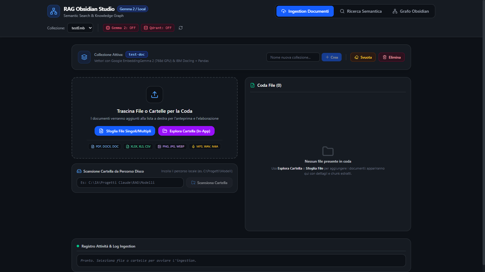
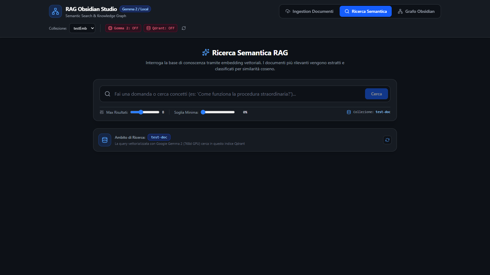
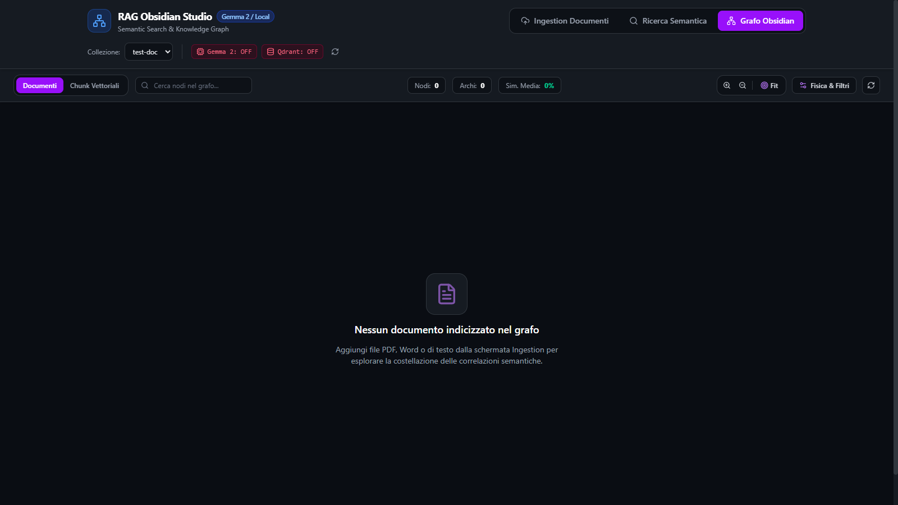
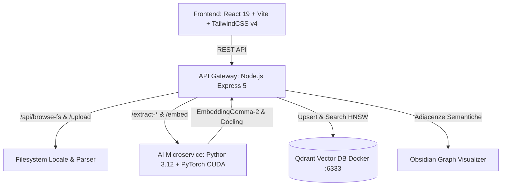

# Local Multimodal RAG & Knowledge Graph Studio

[](LICENSE)
[](https://python.org)
[](https://nodejs.org)
[](https://qdrant.tech)
[](https://pytorch.org)
[](https://react.dev)

Una piattaforma enterprise autonoma, **100% on-premise** e privacy-first per:
1. **Ingestion Documentale Ricorsiva & Multi-Formato**: PDF, DOCX/DOC, fogli Excel (.xlsx e .xls legacy con IBM Docling e fallback Pandas), presentazioni PPTX, immagini e registrazioni audio.
2. **Embedding Semantico Accelerato su GPU**: Microservizio locale con Google `EmbeddingGemma-2` (768 dimensioni) su CUDA (NVIDIA).
3. **Database Vettoriale Qdrant**: Storage e ricerca vettoriale HNSW su Docker con metadati strutturati e filtri per collezione.
4. **Ricerca Semantica & Sintesi RAG con LLM (Gemma 2)**: Query in linguaggio naturale con embedding GPU su Qdrant, sintesi documentale strutturata per documento (`# Documento consultato: [file]`), visualizzatore documenti integrato con auto-scroll ed evidenziazione al paragrafo esatto, e interfaccia multilinea non-bloccante.
5. **Obsidian-Style Knowledge Graph Studio**: Grafo interattivo 2D/3D con calcolo in tempo reale delle correlazioni semantiche per cosine similarity tra documenti e chunk vettoriali.

---

## 📸 Anteprima Interfaccia Utente

### 1. Ingestion Documentale Ricorsiva & Monitor Coda
> Scansione ricorsiva di cartelle e sottocartelle del sistema locale, estrazione multi-formato (Docling + Pandas), coda di lavoro interattiva e log in tempo reale stile terminale.



---

### 2. Ricerca Semantica RAG & Perimetro Documenti
> Interrogazione vettoriale su GPU con slider della soglia minima di accuratezza a passo unitario (1%) e scheda ambito collezione per conoscere l'esatto perimetro dei documenti indicizzati.



---

### 3. Obsidian Knowledge Graph Studio
> Mappa interattiva delle correlazioni semantiche con controlli di navigazione (Zoom In/Out, Fit-to-Screen), visualizzazione a livello Documento o Chunk e clustering pesato per similarità coseno.



---

## 🏛️ Architettura di Sistema



---

## 🚀 Funzionalità Principali

- **Scansione Ricorsiva Intelligente**: Naviga nelle cartelle del computer tramite il file explorer integrato (senza popup nativi del browser) e carica automaticamente tutti i file inclusi nelle sottocartelle preservando la struttura relativa.
- **Parsing Ibrido Robusto**: Estrazione avanzata con IBM Docling integrato con supporto a tabelle complesse e fallback automatico Pandas per fogli Excel `.xls`/`.xlsx`.
- **RAG Studio & Assistente Generativo AI**:
  - **Sintesi Strutturata per Documento**: l'LLM raggruppa le risposte per ciascun file consultato con intestazioni `# Documento consultato: [nome_file]` e concetti chiave evidenziati in grassetto.
  - **Separazione Modalità di Ricerca**: *"Rispondi con AI"* mostra esclusivamente la risposta sintetica pulita; *"Solo Frammenti"* mostra le card dettagliate di tutti i chunk vettoriali.
  - **Visualizzatore Documenti Integrato (In-App Reader)**: apertura con un click del testo integrale del documento da Qdrant, auto-scroll al paragrafo esatto, evidenziazione `⭐ Risposta trovata qui` e pulsante di copia rapida per Word/Acrobat (<kbd>Ctrl + F</kbd>).
  - **Area Domanda Ergonomica**: campo `<textarea>` multilinea (<kbd>Shift + Invio</kbd>) con pulsanti posizionati nella barra inferiore per non sovrapporsi mai al testo.
  - **Deduplicazione Fonti Consultate**: visualizzazione dei soli file distinti con indicazione di pagine e numeri di paragrafo/chunk.
- **Barra di Stato Processi Unificata (Navbar)**:
  - 🟢 **Verde** (Online) / 🔴 **Rosso** (Down) per tutti e tre i motori: `Embedding: GPU` (EmbeddingGemma-2), `LLM: gemma2:2b` (Ollama), `Qdrant: ON` (Database vettoriale con GPU).
- **Nessuna Fuga di Dati (Zero Cloud Leakage)**: Nessun dato lascia la macchina locale. Massima conformità GDPR per documenti sensibili e bilanci.
- **Grafo di Conoscenza Dinamico**: Navigazione visuale con comandi rapidi (Zoom In, Zoom Out, Fit-to-screen) e clustering cromatico basato sulla similarità coseno.

---

## 🛠️ Prerequisiti

- **Node.js** v20+ e **npm**
- **Python** v3.11 o v3.12 con supporto CUDA (opzionale ma consigliato per GPU NVIDIA)
- **Docker & Docker Compose** (per Qdrant Vector DB)

---

## ⚡ Avvio Rapido 100% in Container (Zero Configurazione Locale)

Non è più necessario eseguire comandi manuali come `npm run dev` o configurare ambienti virtuali: l'intero stack (Frontend React, API Express, Microservizio AI Python con Docling/EmbeddingGemma-2, Qdrant e Ollama) viene avviato all'interno di container Docker coordinati.

```bash
docker compose up -d
```

Questo singolo comando avvierà tutti i servizi:
- **`rag-studio`**: Frontend Web React + API Express (`http://localhost:5173` o `http://localhost:3001`) e Microservizio Python Embedding (`http://localhost:5002`)
- **`rag-qdrant`**: database vettoriale accelerato (`http://localhost:6333`)
- **`rag-ollama`**: runtime LLM Ollama (`http://localhost:11434`) con modelli persistiti nella cartella di progetto `./ollama_storage`

Apri semplicemente il browser su **`http://localhost:5173`** o **`http://localhost:3001`**.

---

### Sviluppo Locale (Opzionale)

Se desideri apportare modifiche al codice sorgente in modalità hot-reload senza container:

```bash
# 1. Avvia solo Qdrant e Ollama in background
docker compose up -d qdrant ollama

# 2. Configura il venv Python (solo prima volta)
python -m venv .venv
.\.venv\Scripts\Activate.ps1
pip install -r requirements.txt

# 3. Avvia lo stack dev locale
npm install
npm run dev
```

---

## 📄 Licenza
Rilasciato sotto licenza [MIT](LICENSE).
