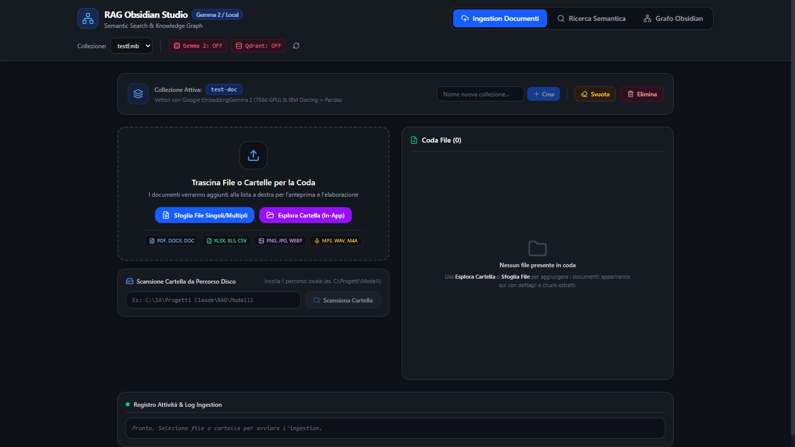
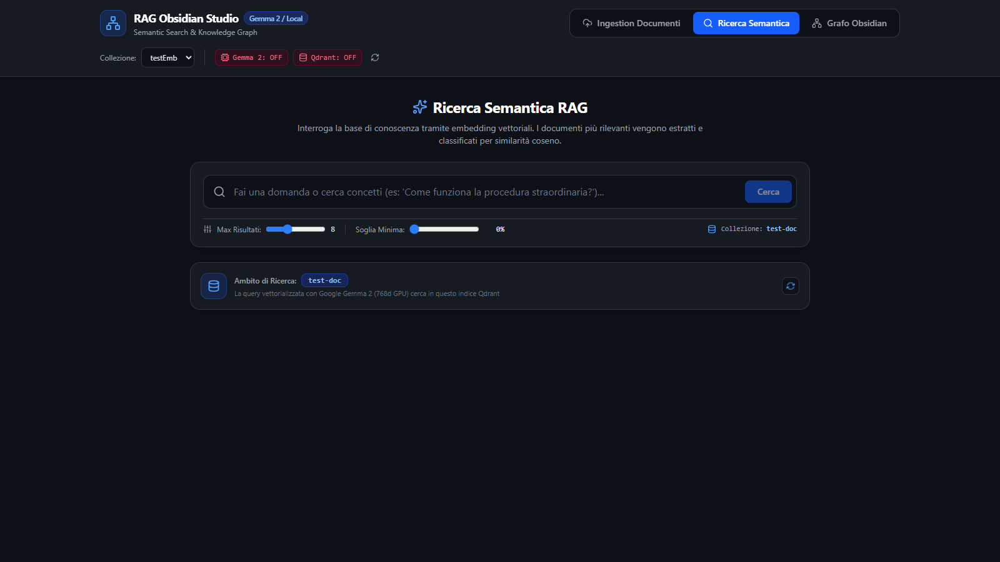
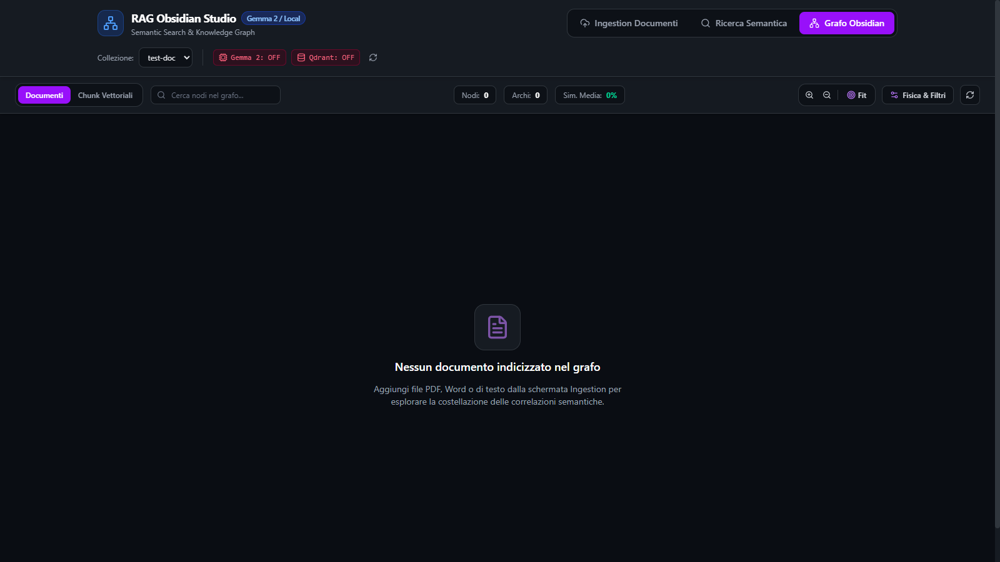
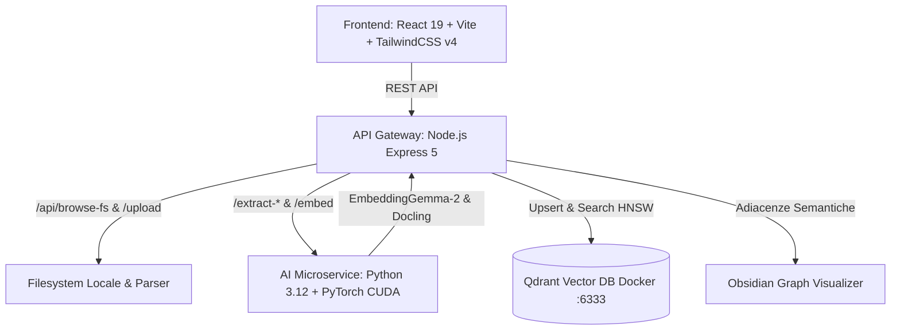

# Local Multimodal RAG & Knowledge Graph Studio

[](LICENSE)
[](https://python.org)
[](https://nodejs.org)
[](https://qdrant.tech)
[](https://pytorch.org)
[](https://react.dev)

Una piattaforma enterprise autonoma, **100% on-premise** e privacy-first per:
1. **Ingestion Documentale Ricorsiva & Multi-Formato**: PDF, DOCX/DOC, fogli Excel (.xlsx e .xls legacy con IBM Docling e fallback Pandas), presentazioni PPTX, immagini e registrazioni audio.
2. **Embedding Semantico Accelerato su GPU**: Microservizio locale con Google `EmbeddingGemma-2` (768 dimensioni) su CUDA (NVIDIA).
3. **Database Vettoriale Qdrant**: Storage e ricerca vettoriale HNSW su Docker con metadati strutturati e filtri per collezione.
4. **Ricerca Semantica RAG**: Query in linguaggio naturale con soglia minima di accuratezza a step unitario (1%) e visualizzazione dell'ambito dei documenti indicizzati.
5. **Obsidian-Style Knowledge Graph Studio**: Grafo interattivo 2D/3D con calcolo in tempo reale delle correlazioni semantiche per cosine similarity tra documenti e chunk vettoriali.

---

## 📸 Anteprima Interfaccia Utente

### 1. Ingestion Documentale Ricorsiva & Monitor Coda
> Scansione ricorsiva di cartelle e sottocartelle del sistema locale, estrazione multi-formato (Docling + Pandas), coda di lavoro interattiva e log in tempo reale stile terminale.



---

### 2. Ricerca Semantica RAG & Perimetro Documenti
> Interrogazione vettoriale su GPU con slider della soglia minima di accuratezza a passo unitario (1%) e scheda ambito collezione per conoscere l'esatto perimetro dei documenti indicizzati.



---

### 3. Obsidian Knowledge Graph Studio
> Mappa interattiva delle correlazioni semantiche con controlli di navigazione (Zoom In/Out, Fit-to-Screen), visualizzazione a livello Documento o Chunk e clustering pesato per similarità coseno.



---

## 🏛️ Architettura di Sistema



---

## 🚀 Funzionalità Principali

- **Scansione Ricorsiva Intelligente**: Naviga nelle cartelle del computer tramite il file explorer integrato (senza popup nativi del browser) e carica automaticamente tutti i file inclusi nelle sottocartelle preservando la struttura relativa.
- **Parsing Ibrido Robusto**: Estrazione avanzata con IBM Docling integrato con supporto a tabelle complesse e fallback automatico Pandas per fogli Excel `.xls`/`.xlsx`.
- **Nessuna Fuga di Dati (Zero Cloud Leakage)**: Nessun dato lascia la macchina locale. Massima conformità GDPR per documenti sensibili e bilanci.
- **Grafo di Conoscenza Dinamico**: Navigazione visuale con comandi rapidi (Zoom In, Zoom Out, Fit-to-screen) e clustering cromatico basato sulla similarità coseno.

---

## 🛠️ Prerequisiti

- **Node.js** v20+ e **npm**
- **Python** v3.11 o v3.12 con supporto CUDA (opzionale ma consigliato per GPU NVIDIA)
- **Docker & Docker Compose** (per Qdrant Vector DB)

---

## ⚡ Avvio Rapido

### 1. Avvia il Database Vettoriale (Qdrant)
```bash
docker-compose up -d
```
Verifica che la dashboard Qdrant sia attiva su `http://localhost:6333/dashboard`.

### 2. Configura l'Ambiente Python
```bash
# Crea virtual environment
python -m venv .venv
source .venv/bin/activate # su Windows: .\.venv\Scripts\Activate.ps1

# Installa le dipendenze
pip install -r requirements.txt
```

### 3. Installa le Dipendenze Node e Avvia la Piattaforma
```bash
npm install
npm run dev
```

Il comando `npm run dev` avvierà simultaneamente:
- **Python Service (EmbeddingGemma-2 + Docling)** su `http://localhost:5002`
- **Express API Gateway** su `http://localhost:3001`
- **Vite React Frontend** su `http://localhost:5173`

---

## 📊 Presentazione del Progetto
È inclusa una presentazione PowerPoint professionale a 5 slide in formato 16:9 widescreen con immagini della GUI:
- [`Presentazione_RAG_Studio.pptx`](./Presentazione_RAG_Studio.pptx)

---

## 📄 Licenza
Rilasciato sotto licenza [MIT](LICENSE).
